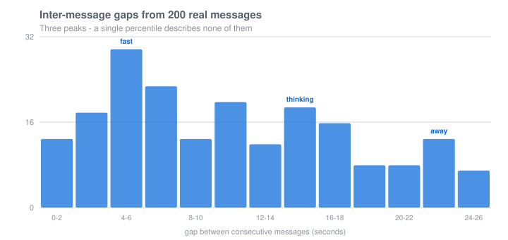
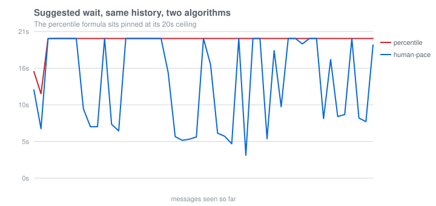

# human-pace

**Decide when to reply, based on how the person actually types.**

[]()
[]()
[]()

---

## The bug almost every chat bot has

I logged 200 real inter-message gaps from a chat companion I run. Here they are:



Three peaks. Not two — three. Roughly:

- **0–4s** — streaming short fragments, thinking out loud
- **4–8s** — normal sentence pacing
- **10–26s** — paused to think, or switched to another window

Now look at what the standard implementation does with that history. Almost
every "typing delay" you will find does something like this:

```python
base = max(median(gaps), p75(gaps)) * 1.5      # 16.19 * 1.5 = 24.29
cap  = min(20, max(10, p90(gaps) * 1.2))       # min(20, 26.35) = 20
window = clamp(base, 2.5, cap)                 # -> 20.0
```

`base` exceeds the cap, so the clamp pins it. **The result is 20 seconds,
every time, forever.** The "adaptive" code has a constant for an output.

Run over the real history, step by step:



| | distinct values | range |
|---|---|---|
| percentile formula | **2 / 17 samples** | 4.73s |
| human-pace | **10 / 17 samples** | 16.73s |

Two distinct values out of seventeen. That is what "adaptive" looks like when
nobody checks.

## Why it happens

A multi-peaked distribution has no single representative value. Asking for
"the P75 gap" of a three-peaked distribution produces a number that describes
nobody: it tells you 75% of gaps fall below 16 seconds, which does not answer
the only question you have.

And the failure is silent. There is no error, no warning. The code is correct
Python, the formula is arithmetically right, and the output is a constant. You
only find it by plotting what it actually returns.

## The question to ask instead

Not *"how long should I wait"* but *"is this thought finished"*.

Two things answer that, and neither is a percentile:

**1. Which mode is he in right now.** Cluster the recent gaps into
fast / mid / slow, then look at where the *latest* gap landed. Recent evidence
beats aggregate statistics — an active burst means more is coming.

**2. How does the sentence end.** Timing cannot distinguish "he is thinking"
from "he finished". Punctuation can:

| ending | reading | effect |
|---|---|---|
| `你去吗？` · `行不行` | waiting for an answer | ×0.35, hard cap 2s |
| `好的` · `行` | thought closed | ×0.60, hard cap 4s |
| `我今天下午去了一趟那个…` · `还有个事，` | trailing off | ×1.45, no cap |
| `啊` (bare fragment) | ambiguous | ×1.20, cap 8s |
| long, no punctuation | probably done | ×0.85 |

The caps matter. A slow typist has a large base window, and multiplying it by
0.6 still produces 11 seconds — but "好的" is a finished thought regardless
of how fast its author types. Real people answer it in three seconds.

## Result on the same history

| message | wait |
|---|---|
| `你去吗？` | 2.00s |
| `好的` | 4.00s |
| `啊` | 8.00s |
| (no text) | 19.07s |
| `我今天下午去了一趟那个…` | 20.00s |

An 18-second spread, driven by the message rather than by the clock.

## Install

```bash
pip install human-pace
```

No dependencies. Pure standard library.

## Use

```python
from human_pace import Pace

pace = Pace()                       # in-memory
# pace = Pace(sqlite_path="pace.db")  # survives restarts

# Every incoming message:
pace.observe(user_id, text=text)

# Before replying:
r = pace.decide(user_id, text=text)
if r.done:
    reply()
else:
    await asyncio.sleep(r.wait)
    reply()
```

`decide()` returns a `Decision`:

```python
r.done        # bool   - reads as a complete thought
r.wait        # float  - suggested delay, seconds
r.reason      # str    - which signal fired
r.mode        # str    - "fast" / "mid" / "slow" / "cold"
r.confidence  # float  - 0..1, scaled by sample count

print(r.explain())
# mode=fast(3.30s) | last gap 2.26s | sentence finished x0.60
# | base 4.95s -> wait 2.97s | done=True | n=20
```

If you already have a merge/drain loop, `pace.window(uid, text)` returns just
the number.

### Persistent history

Typing pace is a property of the *person*, not of the process. After a deploy
you should not have to re-learn that this user types slowly:

```python
pace = Pace(sqlite_path="~/.mybot/pace.db")
```

Keys are arbitrary strings — user id, chat id, whatever identifies a
conversation partner.

## How it works

```
observe(key, text, ts)
    gap = ts - last_ts[key]
    drop if gap < 0.3s (client split one message)
    drop if gap > 25s  (he walked away; new conversation)
    store gap

decide(key, text)
    if len(history) < 8:  base = 3.0s, mode = "cold"
    else:
        centers, groups = kmeans1d(history[:20], k=3)
        j     = cluster containing history[0]      # latest gap
        base  = median(groups[j]) * 1.5
        cap   = min(20s, max(10s, p90(history) * 1.2))
        base  = clamp(base, 2.5s, cap)

    mult, hard_cap = signal(text)
    wait = min(base * mult, hard_cap) if hard_cap else base * mult
    wait = clamp(wait, floor, 20s)
```

Three details that took iterating to get right:

**Medians in the k-means update step, not means.** One outlier — he walked
away for 20 seconds — would otherwise drag a cluster center and poison the
next several decisions.

**The mode label compares against the overall median, not the cluster index.**
If every gap is slow, all three centers are slow and index 0 would be
labelled "fast".

**A signal cap lowers the floor too.** Otherwise `min_window = 2.5` silently
undoes a 2.0s question cap, and you are back to a number that ignores its own
input.

## Tuning

```python
from human_pace import Pace, PaceConfig

cfg = PaceConfig(
    default_window=3.0,   # used until enough samples
    min_window=2.5,       # never suggest faster than this
    max_window=20.0,      # hard ceiling
    factor=1.5,           # base multiplier before signal scaling
    min_samples=8,        # below this, do not adapt
    mode_samples=20,      # window fed to clustering
    mode_k=3,             # fast / mid / slow
)
pace = Pace(config=cfg)
```

## Limitations

Being explicit, because a library like this is easy to over-trust:

- **Sentence signals are Chinese-oriented.** The regexes cover `？ 吗 么`, the
  A-not-A pattern (`来不来`), `。！~`, `，、—：`, and `…`. Other languages need
  their own `signals.py`; the pacing logic is language-independent.
- **k=3 is a guess.** Some people have two modes, some have four. The cluster
  containing the latest gap still works, but `mode` becomes less meaningful.
- **This does not make a bot seem human.** It removes one specific tell: an
  answer that arrives on a fixed clock regardless of what was said.
- **25s is a hard cut.** Longer silences are treated as a new conversation,
  which is right for chat and wrong for asynchronous threads.
- **8 samples before it adapts.** Below that it uses the default, which is
  intentionally boring.

## Tests

```bash
pytest -q      # 51 passed
```

Including a regression test for the saturation bug:

```python
def test_regression_window_does_not_saturate():
    """The bug this library exists to avoid."""
    gaps = ([2.0, 3.1, 1.8, 2.5, 4.0] * 4) + ([14.0, 15.2, 13.8, 16.0] * 5)
    naive = 20.0   # percentile formula, clamped to its own ceiling

    pace = Pace()
    feed(pace, "u1", gaps)
    windows = {pace.window("u1", text=t)
               for t in ["好的", "你去吗？", "我今天下午去了一趟那个…", "啊"]}

    assert len(windows) > 1
```

## Where the data came from

`examples/sample_gaps.json` holds the 200 gaps above. **Numbers only** — no
message text, no timestamps, no identifiers. Collected from a single user over
about three weeks of ordinary conversation.

Reproduce every number in this README:

```bash
python examples/simulate.py    # the comparison table
python examples/make_chart.py  # regenerate both SVGs
python examples/demo.py        # minimal usage
```

## License

MIT.
