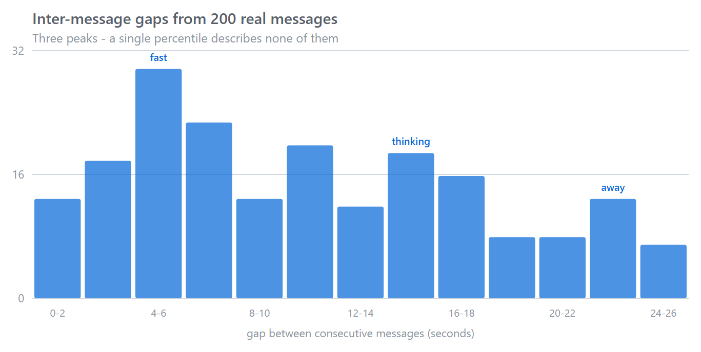
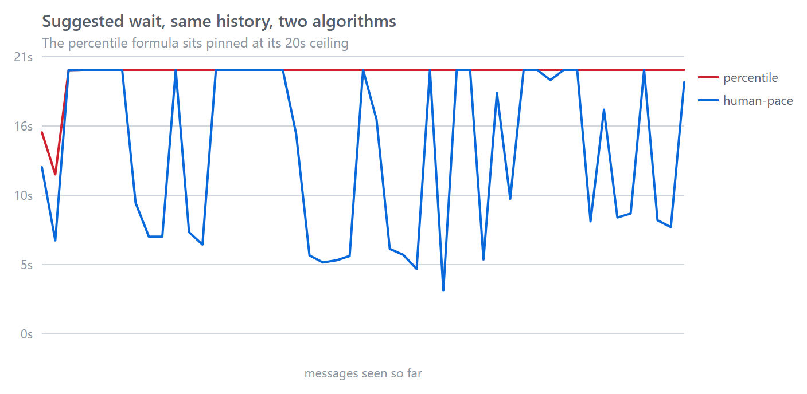

# human-pace

**根据对方真实的打字节奏，决定什么时候该回。**

[]()
[]()
[]()

---

## 几乎每个聊天机器人都有这个 bug

我把自己跟一个陪聊机器人聊天的 200 次消息间隔记了下来，画出来是这样：



**三个峰，不是两个。** 大致是：

- **0–4 秒** —— 一句拆成几条往外倒，边想边说
- **4–8 秒** —— 正常说话节奏
- **10–26 秒** —— 停下来想事情，或者切到别的窗口去了

现在看看标准实现拿这份历史数据算出了什么。几乎所有"打字延迟"的实现都是这个套路：

```python
base = max(median(gaps), p75(gaps)) * 1.5      # 16.19 * 1.5 = 24.29
cap  = min(20, max(10, p90(gaps) * 1.2))       # min(20, 26.35) = 20
window = clamp(base, 2.5, cap)                 # → 20.0
```

`base` 超过了 `cap`，于是被夹住。**结果是每次 20 秒，永远。** 这段"自适应"代码的输出是一个常数。

在真实历史上逐条跑一遍：



| | 不同取值 | 极差 |
|---|---|---|
| 分位数公式 | **2 / 17 次采样** | 4.73 秒 |
| human-pace | **10 / 17 次采样** | 16.73 秒 |

十七次采样只有两个不同的值。这就是没人验证过的"自适应"长什么样。

## 为什么会这样

**多峰分布没有单一代表值。** 对三峰分布问"P75 间隔是多少"，得到的数字描述不了任何人：它只告诉你 75% 的间隔在 16 秒以内，而你唯一想知道的问题它没回答。

而且**这种失败是静默的**。没有报错，没有警告。代码是合法的 Python，公式在算术上完全正确，输出是一个常数。你只有把它真正返回的值画出来，才会发现。

## 该问的问题

不是"我该等多久"，而是"**这句话说完了没**"。

两样东西能回答它，都不需要分位数：

**① 他此刻在哪个模态。** 把最近的间隔聚成快 / 中 / 慢三簇，然后看*最新一条*落在哪簇。近期证据比整体统计可靠——连着发短句，说明后面还有。

**② 这句话是怎么结束的。** 时间永远分不清"他在想"和"他说完了"，标点可以：

| 结尾 | 读作 | 处理 |
|---|---|---|
| `你去吗？` · `行不行` | 在等你回答 | ×0.35，硬上限 2 秒 |
| `好的` · `行` | 这个念头结束了 | ×0.60，硬上限 4 秒 |
| `我今天下午去了一趟那个…` · `还有个事，` | 话没说完 | ×1.45，不设上限 |
| `啊`（孤立短句） | 模棱两可 | ×1.20，上限 8 秒 |
| 长句无标点 | 基本说完了 | ×0.85 |

**硬上限是关键。** 慢节奏的人基础窗口很大，乘 0.6 还是 11 秒——但"好的"是一句说完的话，跟作者打字快慢无关。真人三秒就回了。

## 同一份历史上的结果

| 这句话 | 等待 |
|---|---|
| `你去吗？` | 2.00 秒 |
| `好的` | 4.00 秒 |
| `啊` | 8.00 秒 |
| （无文本） | 19.07 秒 |
| `我今天下午去了一趟那个…` | 20.00 秒 |

**18 秒的跨度，由"这句话是什么"决定，而不是由时钟决定。**

## 安装

```bash
pip install human-pace
```

无依赖，纯标准库。

## 用法

```python
from human_pace import Pace

pace = Pace()                       # 内存
# pace = Pace(sqlite_path="pace.db")  # 重启后还记得

# 每收到一条消息：
pace.observe(user_id, text=text)

# 决定要不要现在回：
r = pace.decide(user_id, text=text)
if r.done:
    reply()
else:
    await asyncio.sleep(r.wait)
    reply()
```

`decide()` 返回 `Decision`：

```python
r.done        # bool   这句话读起来完整了没
r.wait        # float  建议延迟，秒
r.reason      # str    是哪条信号生效的
r.mode        # str    "fast" / "mid" / "slow" / "cold"
r.confidence  # float  0..1，按样本量给

print(r.explain())
# mode=fast(3.30s) | last gap 2.26s | sentence finished x0.60
# | base 4.95s -> wait 2.97s | done=True | n=20
```

如果你已经有合并 / drain 循环，`pace.window(uid, text)` 只返回那个数字。

### 持久化历史

**打字节奏是人的属性，不是进程的属性。** 部署一次不该就得重新学"这个用户打字慢"：

```python
pace = Pace(sqlite_path="~/.mybot/pace.db")
```

key 是任意字符串——用户 id、会话 id，或任何能标识对话方的值。

## 原理

```
observe(key, text, ts)
    gap = ts - last_ts[key]
    丢弃 gap < 0.3s （客户端把一条消息拆成几段）
    丢弃 gap > 25s  （他走开了，这是新一轮对话）
    存

decide(key, text)
    if 样本 < 8:   base = 3.0s, mode = "cold"
    else:
        centers, groups = kmeans1d(history[:20], k=3)
        j     = history[0] 所属的簇         # 最新那条间隔
        base  = median(groups[j]) * 1.5
        cap   = min(20s, max(10s, p90(history) * 1.2))
        base  = clamp(base, 2.5s, cap)

    mult, hard_cap = signal(text)
    wait = min(base * mult, hard_cap) if hard_cap else base * mult
    wait = clamp(wait, floor, 20s)
```

三个迭代出来才对的细节：

**k-means 更新用中位数，不用平均值。** 否则一个离群点（他走开 20 秒）就能拖偏簇心，污染后面好几次判断。

**模态标签比的是整体中位数，不是簇序号。** 如果所有间隔都慢，三个簇心都慢，按序号会把 0 号标成 "fast"。

**信号上限会同时压低地板。** 否则 `min_window = 2.5` 会悄悄把问句的 2.0 秒上限吃掉，你又回到一个连自己输入都不管的数字。

## 调参

```python
from human_pace import Pace, PaceConfig

cfg = PaceConfig(
    default_window=3.0,   # 样本不够时用
    min_window=2.5,       # 再快就显得在打断
    max_window=20.0,      # 硬顶
    factor=1.5,           # 信号缩放前的基础倍数
    min_samples=8,        # 低于这个不开始自适应
    mode_samples=20,      # 送进聚类的窗口
    mode_k=3,             # 快 / 中 / 慢
)
pace = Pace(config=cfg)
```

## 局限

明确写出来，因为这类库很容易被过度信任：

- **句末信号是中文向的。** 正则覆盖 `？ 吗 么`、A 不 A 句式（`来不来`）、`。！~`、`，、—：`、`…`。其他语言需要自己的 `signals.py`；节奏那部分与语言无关。
- **k=3 是猜的。** 有人两种模态，有人四种。取"最新间隔所在的簇"仍然成立，但 `mode` 这个名字的含义会变淡。
- **它不会让机器人显得像人。** 它只消除一个特定的破绽：**不管对方说了什么，回复都按同一个时钟到达**。
- **25 秒是硬切。** 更长的沉默会被当成新对话——这对聊天是对的，对异步留言板是错的。
- **8 个样本才开始自适应。** 在此之前用默认值，故意做得很无聊。

## 测试

```bash
pytest -q      # 51 passed
```

其中包含一条针对"饱和退化"的回归测试：

```python
def test_regression_window_does_not_saturate():
    """这个库存在的理由。"""
    gaps = ([2.0, 3.1, 1.8, 2.5, 4.0] * 4) + ([14.0, 15.2, 13.8, 16.0] * 5)
    naive = 20.0   # 分位数公式，被自己的上限夹死

    pace = Pace()
    feed(pace, "u1", gaps)
    windows = {pace.window("u1", text=t)
               for t in ["好的", "你去吗？", "我今天下午去了一趟那个…", "啊"]}

    assert len(windows) > 1
```

## 数据来源

`examples/sample_gaps.json` 就是上面那 200 个间隔。**只有数字**——没有消息正文、没有时间戳、没有任何身份信息。来自一个用户约三周的日常聊天。

本文所有数字都能复现：

```bash
python examples/simulate.py    # 那张对比表
python examples/make_chart.py  # 重新生成两张 SVG
python examples/demo.py        # 最小用例
```

## 许可

MIT。
